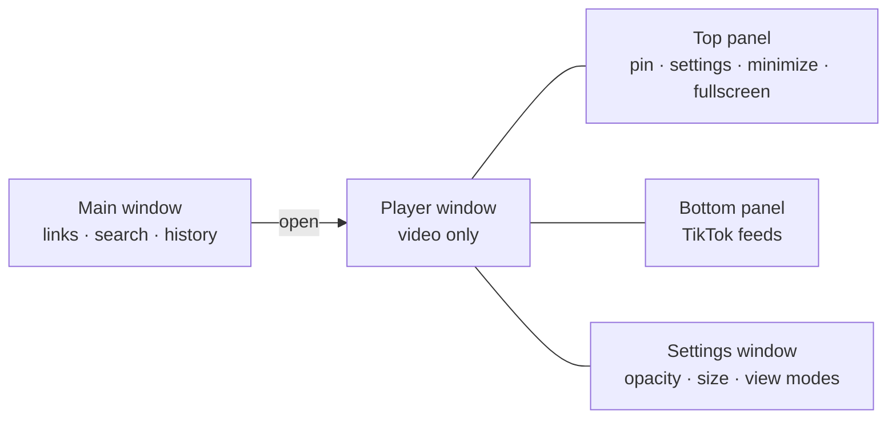

<div align="center">


# Mini Player


**Floating video windows for Windows, Linux and macOS - no browser needed.**
Paste a YouTube, TikTok, Twitch or Vimeo link (or an mp4) and watch it in a small always-on-top window
with control panels that slide out *beside* the video instead of covering it.


**English** · [Русский](README.ru.md)

[**Download the installer**](../../releases/latest) · [Build from source](#build-from-source) · [How it works](#how-it-works)

</div>

---

## Highlights

| | |
|---|---|
| **Mini windows** | Open a link and get a compact player: YouTube (videos, Shorts, playlists), TikTok, Twitch channels, Vimeo, direct mp4/webm files, or any website. |
| **Panels outside the window** | Controls slide out above, below and beside the window on hover - never over the video. Drag the window by any panel. |
| **Fine-grained transparency** | Window, frame and video opacity are separate. Pin on top, minimize, full screen, S/M/L sizes, remembered position and size. |
| **TikTok, decluttered** | Full feed in a slim window with the extra UI removed; hide captions and author names, skip ads and LIVE, auto-scroll, fit the window to each video. |
| **Real search** | Search YouTube and TikTok right from the app: best match preview plus a grid of results with thumbnails. |
| **Continue watching** | Remembers where you stopped (YouTube and local files) and resumes from that second. |
| **Accounts** | Sign in on YouTube, TikTok or Twitch; keep up to four accounts per platform and switch between them. |
| **History, pins, favorites** | Pin or delete recent items, star favorites, clear history without losing what matters. |
| **Keeps playing** | Video and audio continue when the window is minimized. |
| **Real installer** | One `Setup.exe`: shortcuts, uninstaller, optional autostart, and the WebView2 runtime if it is missing. |

## Screenshots

<table>
  <tr>
    <td width="50%"><br><sub><b>Main window</b> - continue watching, pinned and recent videos</sub></td>
    <td width="50%"><br><sub><b>Search</b> - best match and results with thumbnails</sub></td>
  </tr>
  <tr>
    <td width="50%"><br><sub><b>TikTok</b> - open feeds in a slim window</sub></td>
    <td width="50%"><br><sub><b>Settings</b> - layout, window options, TikTok view modes</sub></td>
  </tr>
</table>

> The interface language is currently **Russian**.

## Quick start

1. Download **`MiniPlayer_Setup.exe`** from the [latest release](../../releases/latest) and run it
   (no administrator rights needed; installs to `%LOCALAPPDATA%\Programs\Mini Player`).
2. Paste a link and press **Open** - or press **Open** with an empty field to open the platform's home feed.
3. Hover the top or bottom edge of a player window to reveal the panels.

> The installer is not code-signed, so Windows SmartScreen may warn you:
> click **More info, then Run anyway**.
> Silent install: `MiniPlayer_Setup.exe --silent` · uninstall: `uninstall.exe --uninstall`.

### Linux and macOS

These builds use Qt WebEngine instead of WebView2 (same features, same interface).

- **Linux:** download the `.tar.gz` or the `.AppImage` from the releases page. For the AppImage run `chmod +x MiniPlayer*.AppImage && ./MiniPlayer*.AppImage`. On Wayland the app runs through XWayland.
- **macOS:** open the `.dmg` (Apple Silicon or Intel) and drag Mini Player to Applications. The app is not notarized, so on first launch right-click it and choose **Open**.

Linux and macOS builds are produced by the GitHub Actions workflow in `.github/workflows/build.yml`, or you can build them yourself (see below).

## How it works



The app is a native **Rust** program ([wry](https://github.com/tauri-apps/wry) + [tao](https://github.com/tauri-apps/tao), Microsoft Edge **WebView2**) that hosts several
windows. The player window shows only the video; the panels are separate frameless windows that follow it around
and appear when the cursor reaches the edge. TikTok pages are cleaned with an injected script; accounts are stored as
encrypted browser sessions so you can switch between them.

## Build from source

```powershell
pip install -r requirements.txt     # Python is used for the UI build and the installer

# build the app and the installer (needs Rust: https://rustup.rs)
.\build.ps1                 # -> dist\MiniPlayer\ (folder)  and  installer\dist\MiniPlayer_Setup.exe
```

Requires Windows 10/11, Rust (stable) and Python 3.12+. Without Visual Studio Build Tools the GNU toolchain with gcc (e.g. WinLibs) is used. The previous Python version is still in the repository (`miniplayer.py`, `plat/`) and is what the Linux and macOS builds use.

**Linux / macOS:**

```bash
pip install -r requirements-qt.txt
python build_ui.py
python miniplayer.py                 # run directly
bash scripts/build_unix.sh           # or build a bundle (tar.gz on Linux, .app on macOS)
```

Linux needs the usual Qt/xcb libraries (on Debian or Ubuntu: `libxcb-cursor0 libxkbcommon-x11-0 libnss3`). Setting `MP_QT=1` also runs the Qt backend on Windows.

## Project structure

| Path | What it is |
|---|---|
| `rs/` | The app (Rust): windows, JS bridge, panels, accounts, search, bypass mode |
| `miniplayer.py`, `plat/` | The previous Python version (used for Linux and macOS builds) |
| `ui_template.html` | The main window (single HTML/CSS/JS file); `build_ui.py` embeds icons and writes `ui.html` |
| `player.html` | Player window page (YouTube IFrame API, Twitch chat, local files) |
| `panel.html` | Panel pages: top, bottom (TikTok feeds) and settings |
| `tiktok_inject.js` | Cleans up tiktok.com, hides ads, controls auto-scroll |
| `icons/` | Icon set (`*_clay.png` are the hand-drawn ones; `svg/` holds the sources of the rest) |
| `installer/installer.py` | Installer and uninstaller (tkinter) |
| `build.ps1` | One-command build |
| `docs/` | Banner and screenshots |

## Bypass mode (Windows, optional)

Settings has a switch that helps open YouTube, Twitch and other blocked sites where they are slowed down or blocked; TikTok and Netflix are connected directly. It works **only inside this app**: the app runs a local proxy for its own windows and a [zapret](https://github.com/bol-van/zapret) `winws` instance that filters only the proxy's reserved source ports (52000-52999), so other programs and browsers are not touched. The app tries several strategies and keeps the one that works on your network.

- Needs administrator rights (one Windows UAC prompt per app launch, only if the mode is on). Switching it on or off does not restart the app; while it is off, connections go out normally.
- Does not help with IP or DNS blocks, and cannot make a service available in a region where it does not operate.
- Antivirus software may flag `winws.exe` and the WinDivert driver; this is typical for such tools. Their sources are linked below.
- Third-party components in `third_party/zapret`: [zapret](https://github.com/bol-van/zapret) by bol-van (MIT) and [WinDivert](https://github.com/basil00/WinDivert) by basil00 (LGPLv3 / GPLv2).

## Privacy and data

Everything is stored locally in `%APPDATA%\MiniPlayer` (Linux: `~/.local/share/MiniPlayer`, macOS: `~/Library/Application Support/MiniPlayer`): settings and history (`data.json`), the embedded browser profile
(`web`) and a crash log (`crash.log`). Saved sessions of multiple accounts live in `accounts.bin`, **encrypted with
Windows DPAPI - only your Windows user can decrypt it** (on Linux and macOS: Fernet, with the key kept in the system keyring or a `0600` key file). Never share that file.
The app talks only to the sites you open (YouTube, TikTok, Twitch, …); it has no telemetry.

## Notes

- Not affiliated with YouTube, TikTok, Twitch or Vimeo; all names belong to their owners.
- Hiding TikTok interface elements, reading account names and TikTok search rely on how those sites are built and may
  break when they change.
- Videos whose authors disabled embedding can't be played inside the app (use **Open in browser** from the window settings).
