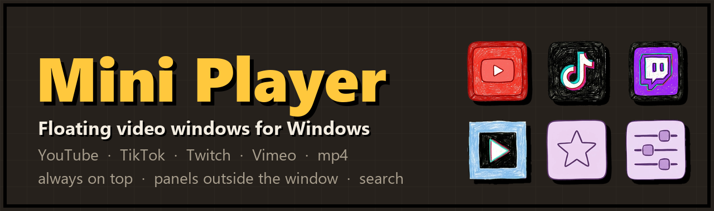
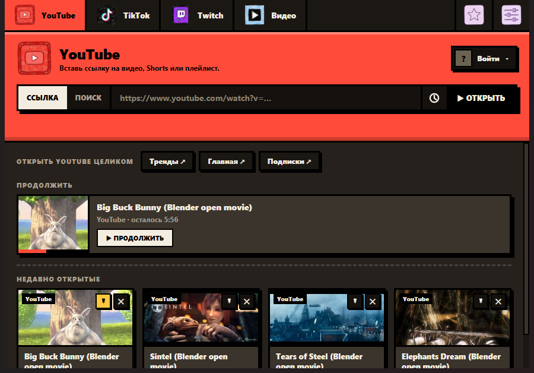
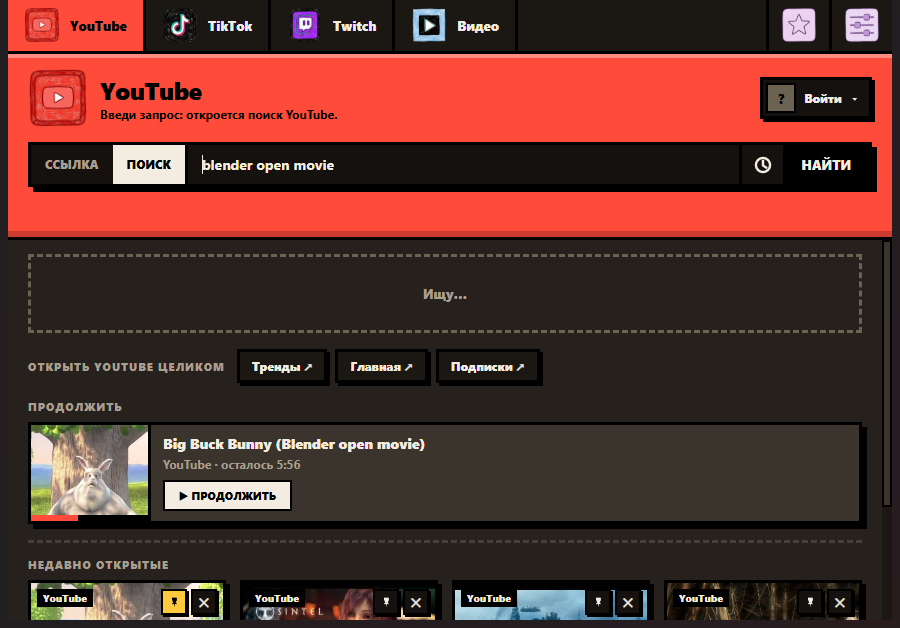
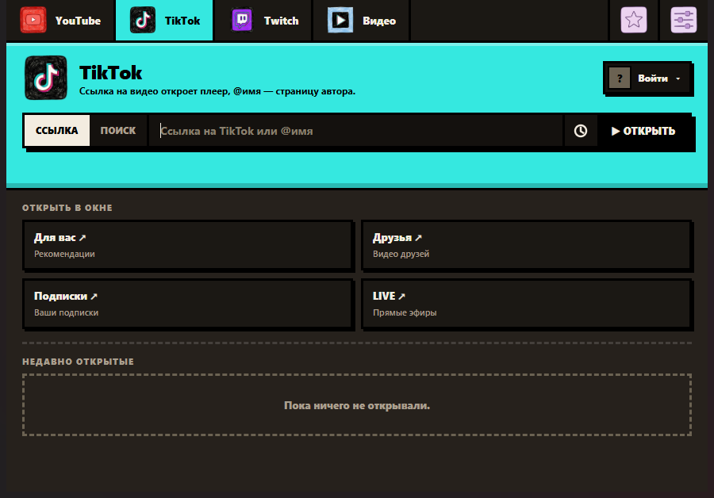
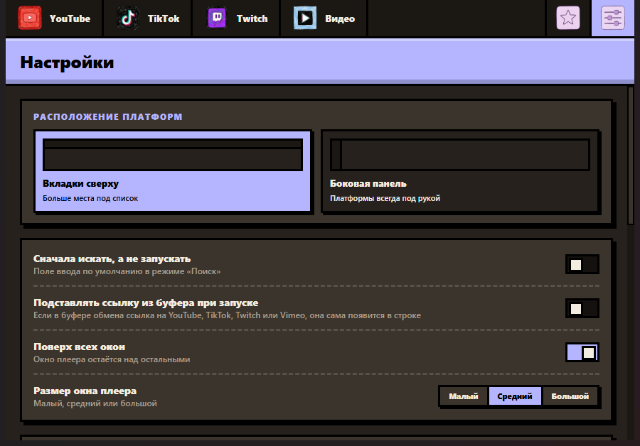
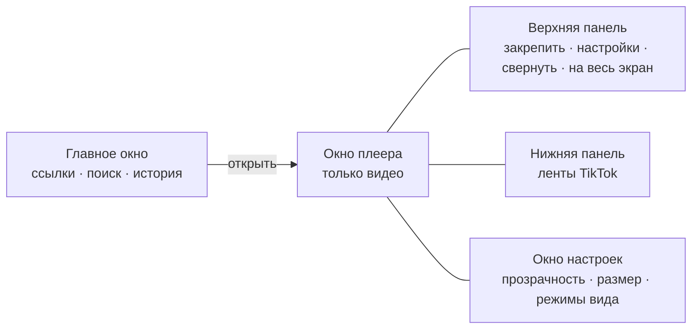

<div align="center">



**Плавающие видео-окна для Windows, Linux и macOS - браузер не нужен.**
Вставьте ссылку на YouTube, TikTok, Twitch или Vimeo (или mp4) и смотрите в маленьком окне поверх остальных.
Панели управления выезжают *рядом* с видео, а не закрывают его.


[English](README.md) · **Русский**

[**Скачать установщик**](../../releases/latest) · [Сборка из исходников](#сборка-из-исходников) · [Как устроено](#как-устроено)

</div>

---

## Возможности

| | |
|---|---|
| **Мини-окна** | Откройте ссылку - появится компактный плеер: YouTube (видео, Shorts, плейлисты), TikTok, каналы Twitch, Vimeo, прямые mp4/webm или любой сайт. |
| **Панели снаружи окна** | Управление выезжает сверху, снизу и сбоку при наведении и не перекрывает видео. Окно двигается за любую панель. |
| **Прозрачность по частям** | Отдельно окно, рамка и видео. «Поверх всех окон», свернуть, полный экран, размеры S/M/L, запоминание позиции и размера. |
| **TikTok без лишнего** | Полная лента в узком окне без лишнего интерфейса; скрытие описания и ника, рекламы и LIVE, автопрокрутка, подгонка окна под видео. |
| **Настоящий поиск** | Поиск по YouTube и TikTok прямо в приложении: лучшее совпадение и сетка результатов с обложками. |
| **Продолжить** | Запоминает, где вы остановились (YouTube и локальные файлы), и продолжает с этого места. |
| **Аккаунты** | Вход на YouTube, TikTok и Twitch; до четырёх аккаунтов на платформу и быстрое переключение. |
| **История, закреплённое, избранное** | Закрепляйте и удаляйте недавние, ставьте звёздочки, очищайте историю, не теряя важного. |
| **Играет в фоне** | Видео и звук продолжаются, когда окно свёрнуто. |
| **Настоящий установщик** | Один `Setup.exe`: ярлыки, удаление, автозапуск по желанию и среда WebView2, если её нет. |

## Скриншоты

<table>
  <tr>
    <td width="50%"><br><sub><b>Главное окно</b> - продолжить, закреплённое и недавнее</sub></td>
    <td width="50%"><br><sub><b>Поиск</b> - лучшее совпадение и результаты с обложками</sub></td>
  </tr>
  <tr>
    <td width="50%"><br><sub><b>TikTok</b> - ленты в узком окне</sub></td>
    <td width="50%"><br><sub><b>Настройки</b> - раскладка, окна, режимы вида TikTok</sub></td>
  </tr>
</table>

## Быстрый старт

1. Скачайте **`MiniPlayer_Setup.exe`** из [последнего релиза](../../releases/latest) и запустите
   (права администратора не нужны; ставится в `%LOCALAPPDATA%\Programs\Mini Player`).
2. Вставьте ссылку и нажмите **Открыть**. Если поле пустое, откроется главная лента платформы.
3. Наведите курсор на верхний или нижний край окна плеера, чтобы выехали панели.

> Установщик не подписан цифровой подписью, поэтому Windows SmartScreen может предупредить:
> нажмите **Подробнее  Выполнить в любом случае**.
> Тихая установка: `MiniPlayer_Setup.exe --silent` · удаление: `uninstall.exe --uninstall`.

### Linux и macOS

Эти сборки используют Qt WebEngine вместо WebView2 (те же функции и интерфейс).

- **Linux:** скачайте `.tar.gz` или `.AppImage` из релизов. Для AppImage: `chmod +x MiniPlayer*.AppImage && ./MiniPlayer*.AppImage`. В Wayland приложение работает через XWayland.
- **macOS:** откройте `.dmg` (Apple Silicon или Intel) и перетащите Mini Player в «Программы». Приложение не нотаризовано, поэтому при первом запуске нажмите на нём правой кнопкой и выберите **Открыть**.

Сборки для Linux и macOS делает workflow GitHub Actions `.github/workflows/build.yml`; можно собрать и самостоятельно (см. ниже).

## Как устроено



Приложение - программа на **Rust** ([wry](https://github.com/tauri-apps/wry) + [tao](https://github.com/tauri-apps/tao), Microsoft Edge **WebView2**), которая открывает несколько окон. Окно плеера показывает только видео, а панели - отдельные окна без рамки: они следуют за
плеером и появляются, когда курсор у края. Страницы TikTok очищаются внедряемым скриптом; аккаунты хранятся как
зашифрованные сеансы браузера, поэтому между ними можно переключаться.

## Сборка из исходников

```powershell
pip install -r requirements.txt     # Python нужен для сборки интерфейса и установщика

# сборка приложения и установщика (нужен Rust: https://rustup.rs)
.\build.ps1                 # -> dist\MiniPlayer\ (папка)  и  installer\dist\MiniPlayer_Setup.exe
```

Нужны Windows 10/11, Rust (stable) и Python 3.12+. Без Visual Studio Build Tools используется GNU-набор с gcc (например, WinLibs). Прежняя версия на Python осталась в репозитории (`miniplayer.py`, `plat/`): по ней собираются варианты для Linux и macOS.

**Linux / macOS:**

```bash
pip install -r requirements-qt.txt
python build_ui.py
python miniplayer.py                 # запуск напрямую
bash scripts/build_unix.sh           # или сборка (tar.gz на Linux, .app на macOS)
```

На Linux нужны стандартные библиотеки Qt/xcb (Debian и Ubuntu: `libxcb-cursor0 libxkbcommon-x11-0 libnss3`). Переменная `MP_QT=1` запускает Qt-вариант и на Windows.

## Устройство проекта

| Путь | Что это |
|---|---|
| `rs/` | Приложение (Rust): окна, мост JS, панели, аккаунты, поиск, режим обхода |
| `miniplayer.py`, `plat/` | Прежняя версия на Python (по ней собираются Linux и macOS) |
| `ui_template.html` | Главное окно (один HTML/CSS/JS-файл); `build_ui.py` вшивает иконки и создаёт `ui.html` |
| `player.html` | Страница окна плеера (YouTube IFrame API, чат Twitch, файлы) |
| `panel.html` | Страницы панелей: верхняя, нижняя (ленты TikTok) и настройки |
| `tiktok_inject.js` | Чистит tiktok.com, скрывает рекламу, управляет автопрокруткой |
| `icons/` | Набор иконок (`*_clay.png` - нарисованные; `svg/` - исходники остальных) |
| `installer/installer.py` | Установщик и программа удаления (tkinter) |
| `build.ps1` | Сборка одной командой |
| `docs/` | Баннер и скриншоты |

## Режим обхода блокировок (Windows, по желанию)

В настройках есть переключатель, который помогает открыть YouTube, Twitch и другие заблокированные сайты; TikTok и Netflix подключаются напрямую. Он работает **только внутри этого приложения**: приложение поднимает локальный прокси для своих окон и запускает [zapret](https://github.com/bol-van/zapret) `winws`, который фильтрует только зарезервированные порты прокси (52000-52999), поэтому остальные программы и браузеры не затрагиваются. Приложение перебирает несколько стратегий и оставляет ту, что работает в вашей сети.

- Нужны права администратора (один запрос Windows UAC за запуск приложения, и только если режим включён). Переключение режима не перезапускает приложение; пока он выключен, соединения идут как обычно.
- Не помогает при блокировке по IP или DNS и не открывает сервис в регионе, где он не работает.
- Антивирус может ругаться на `winws.exe` и драйвер WinDivert: для таких инструментов это обычное дело. Ссылки на исходники ниже.
- Сторонние компоненты в `third_party/zapret`: [zapret](https://github.com/bol-van/zapret) (bol-van, MIT) и [WinDivert](https://github.com/basil00/WinDivert) (basil00, LGPLv3 / GPLv2).

## Приватность и данные

Всё хранится локально в `%APPDATA%\MiniPlayer` (Linux: `~/.local/share/MiniPlayer`, macOS: `~/Library/Application Support/MiniPlayer`): настройки и история (`data.json`), профиль встроенного браузера (`web`),
журнал сбоев (`crash.log`). Сохранённые сеансы нескольких аккаунтов лежат в `accounts.bin` **в зашифрованном виде
(DPAPI Windows - расшифровать может только ваша учётная запись; на Linux и macOS - Fernet, ключ в системной связке ключей или в файле с правами 0600)**. Никому не отправляйте этот файл.
Приложение обращается только к сайтам, которые вы открываете (YouTube, TikTok, Twitch и т. д.), телеметрии нет.

## Замечания

- Проект не связан с YouTube, TikTok, Twitch и Vimeo; названия принадлежат их владельцам.
- Скрытие элементов TikTok, чтение имён аккаунтов и поиск TikTok опираются на устройство сайтов и могут перестать
  работать, если сайты поменяют вёрстку.
- Видео, у которых автор запретил встраивание, внутри приложения не воспроизводятся (используйте
  **Открыть в браузере** в настройках окна).
